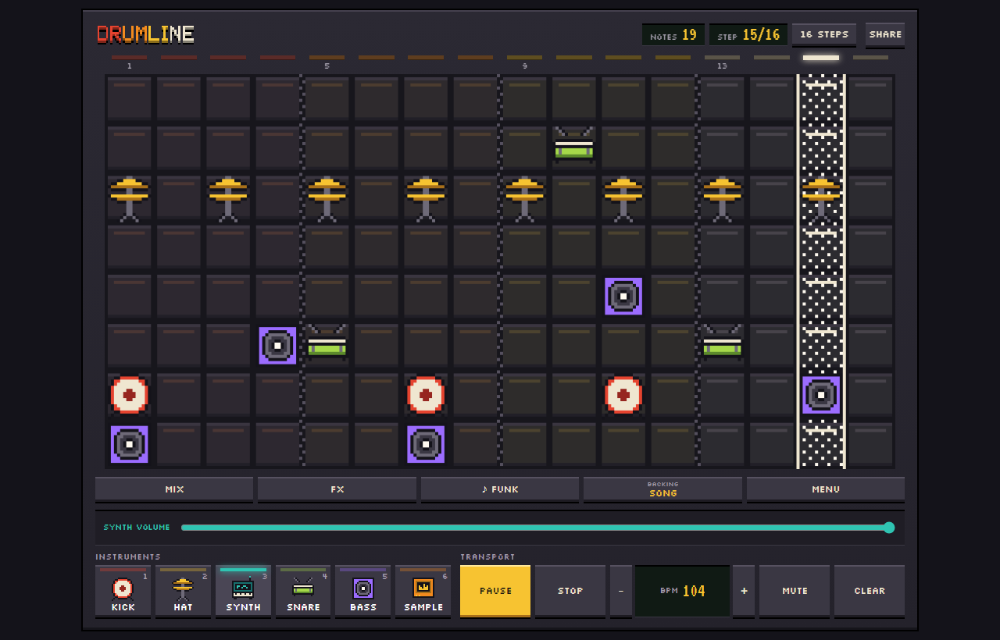
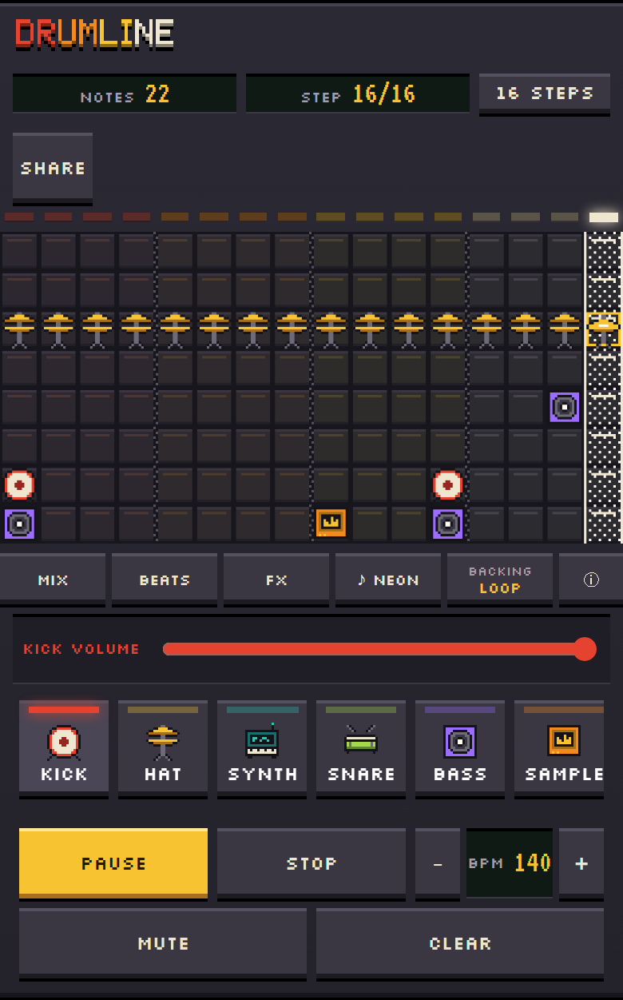
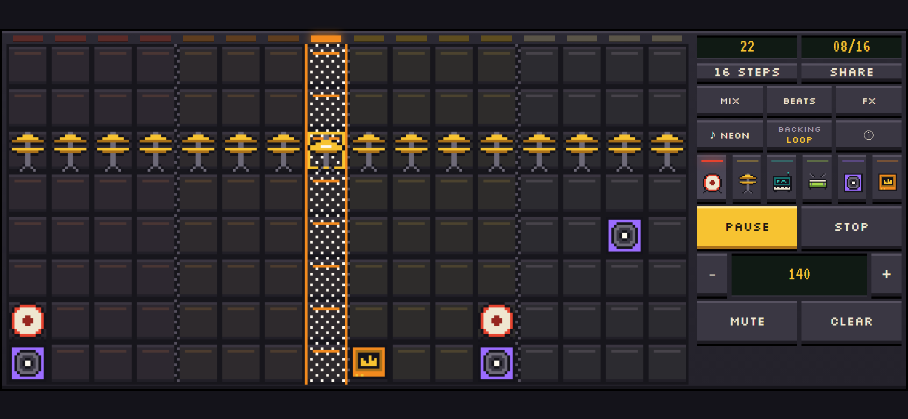

# Drumline Studio

A pixel-art drum machine and synth sequencer that runs in your browser. Paint a beat on the grid,
pick a backing band, and share it with a link. There's nothing to install and no account.

**[▶ Open Drumline Studio](https://stansz.github.io/drumline-studio/)**



## Features

- **Six instruments:** Kick, Hat, Synth, Snare, Bass, and Sample, on a 16- or 32-step grid where
  each row is a pitch.
- **Backing music in five themes:** Neon, Chiptune, Lo-fi, Techno, and Funk, each with its own
  chords, bass, arpeggio, and drums. Play it as a full song, a loop, or not at all.
- **Grooves and tunes:** six ready-made grooves and five public-domain tunes, from the Tetris
  tune to Ode to Joy, plus a random groove maker with undo.
- **Sampler:** six built-in sounds, or record your own from the microphone or a file.
- **Mixer and FX:** a volume for every part, plus filter, delay, reverb, and bit-crush.
- **Share and export:** copy a link, record the audio, or download MIDI for your music app.
- **Works on phones:** turn the phone sideways for a bigger board.
- **Saves itself:** your beat and settings come back next visit.

<p>
  
  
</p>

## Quick start

1. [Open the app](https://stansz.github.io/drumline-studio/) and press **Start**.
2. Pick an instrument and click the grid to paint notes, or open **Beats** and pick a preset.
3. Press **Play** (or **Space**).

**[Read the full guide →](docs/guide.md)** It covers every panel, the keyboard shortcuts, and
phone tips.

## For developers

Drumline Studio is TypeScript, Vite, Canvas, and Web Audio, with no framework and no runtime
dependencies. It was forked from [DrumlineTD](https://github.com/stansz/drumline).

```sh
npm install
npm run dev        # local dev server
npm test           # unit tests
npm run typecheck
npm run build      # type-checks, then writes the static site to dist/
npm run preview    # serves dist/ locally
```

`npm run test:sandbox` runs the same tests inside the Windows `dsh` sandbox, where `npm test` can't
start. Pushing to `main` deploys the site to GitHub Pages through the included workflow, and a
failing test blocks the deploy.

- [docs/references.md](docs/references.md): how the code fits together.
- [docs/themes.md](docs/themes.md): how themes and loudness work.
- [AGENTS.md](AGENTS.md): rules for changing the code.

Live play (the Paint/Live/Rec mode, keys A–K) and the step-light loop are built but turned off with
`LIVE_TOOLS` in `src/config.ts`.

## Built with AI

Drumline Studio is a vibe-coded project. The ideas, design calls, and playtesting are human; most
of the code was written by AI coding tools:

- [Claude Code](https://claude.com/claude-code) planned the features, wrote specs, reviewed and
  tested every change in a headless browser, and wrote the docs.
- [DeepSeek](https://www.deepseek.com/), run through the `dsh` command-line agent, wrote much of
  the code from those specs.

Every change still goes through the unit tests and a browser check before it ships.

## License

The code is under the [MIT License](LICENSE). The fonts keep their own license, below.

## Credits

The Silkscreen and VT323 fonts are used under the SIL Open Font License. Their licenses are in
`src/fonts/`. Korobeiniki (1861), In the Hall of the Mountain King (Grieg, 1875), Ode to Joy
(Beethoven, 1824), Für Elise (Beethoven, 1810), and the Can-Can (Offenbach, 1858) are in the
public domain.
