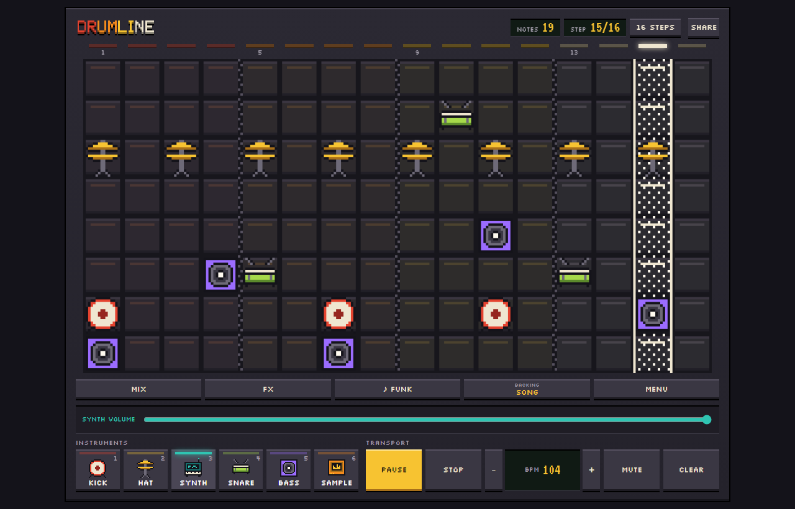
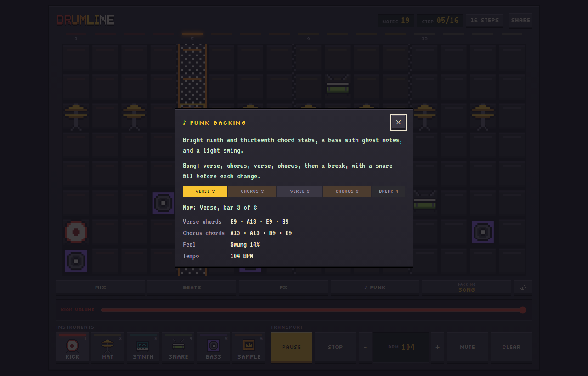
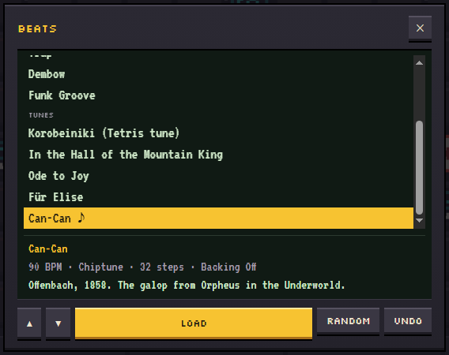
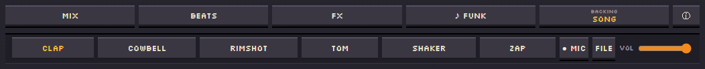
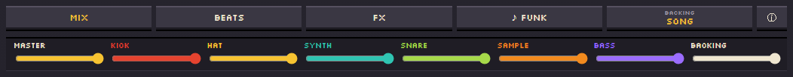
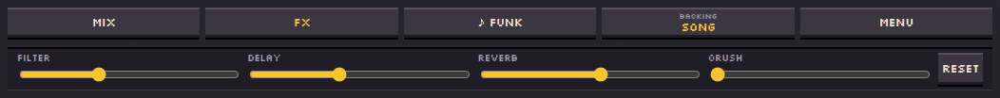
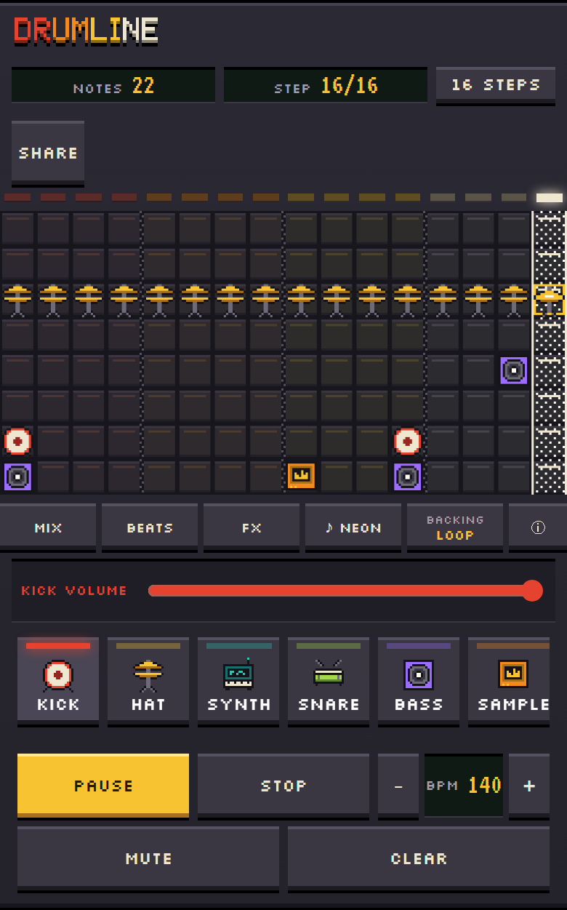
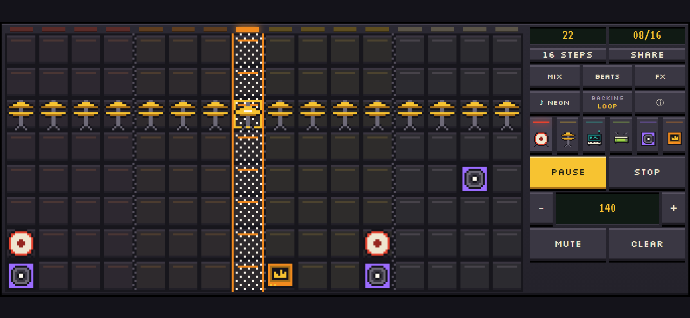

# Drumline Studio guide

Everything you can do in [Drumline Studio](https://stansz.github.io/drumline-studio/), one panel at
a time. For a quick overview, see the [README](../README.md).

- [Quick start](#quick-start)
- [The screen](#the-screen)
- [Painting a pattern](#painting-a-pattern)
- [Playing](#playing)
- [Backing music](#backing-music)
- [Beats: grooves, tunes, and Random](#beats-grooves-tunes-and-random)
- [Sampler](#sampler)
- [Mixer](#mixer)
- [FX](#fx)
- [Saving and sharing](#saving-and-sharing)
- [Keyboard shortcuts](#keyboard-shortcuts)
- [On a phone](#on-a-phone)

## Quick start

1. Open the app and press **Start** to turn on the sound.
2. Pick an instrument from the pads, such as **Kick**, then click cells on the grid to paint notes.
3. Press **Play**.

Or open **Beats** and pick a preset to hear a full groove right away, then change it.

## The screen

- **Header:** the logo, the **Notes** and **Step** readouts, **Length** (16 or 32 steps), **Page**
  and **Follow** (with 32 steps), and **Share**.
- **Board:** the grid. Each column is one step (a sixteenth note), and each row is a pitch.
- **Tab row:** **Mix**, **Beats**, **FX**, **♪ Theme**, **Backing**, and **ⓘ**.
- **Dock:** the slot under the tab row. It shows one panel at a time: the selected instrument's
  volume, the sampler, or whichever of Mix, FX, or Share is open. Opening a panel never moves the
  board.
- **Instruments:** Kick, Hat, Synth, Snare, Bass, and Sample.
- **Transport:** Play, Stop, BPM, Mute, and Clear.

## Painting a pattern

The grid shows 16 steps at a time, and each cell holds at most one note. Pick an instrument, then
click or drag on the grid to paint it. Click or drag over a note to remove it; right-click also
removes.

Rows are pitch. Higher rows tune a kick up, brighten a hat, tighten a snare, play higher notes on
the synth and bass, and pitch the sample up.

**Bass** plays the synth's scale two octaves lower, with the theme's own bass sound. It plays one
note at a time, so a step with several Bass notes keeps one. While your pattern has any Bass notes,
the backing music's bass line goes quiet so the two don't clash.

### Length, pages, and Follow

**Length** switches between 16 and 32 steps. With 32 steps, **Page** flips the board between steps
1–16 and 17–32, and **Follow** appears. While Follow is on, the board flips to whichever page is
playing. Flipping the page yourself turns Follow off. Follow starts on and is remembered. Notes on
steps 17–32 are kept but silent while the length is 16.

## Playing

**Start** on the start screen turns on the sound but doesn't start the beat; press **Play** for
that.

- **Play** starts the beat, and **Pause** holds it where it is. Play again carries on from the same
  step.
- **Stop** halts and goes back to step 1, and the backing song starts again from the top.
- **BPM** sets the tempo from 40 to 300. Type a number, or use **−** and **+** (hold Shift to move
  by 10).
- **Mute** silences everything.
- **Clear** empties the pattern.

## Backing music

Each theme brings its own backing band: chords, a bass line, an arpeggio, and drums. Tap
**♪ Theme** (or press **T**) to step to the next one: Neon, Chiptune, Lo-fi, Techno, and Funk.
Themes change the sound only, never your pattern or the tempo.

**Backing** cycles through three modes:

- **Song** moves through verse, chorus, verse, chorus, and a break, with a short snare fill before
  each change. The chorus has its own chords.
- **Loop** repeats the theme's verse.
- **Off** plays only your pattern, plus a metronome click while the grid is empty.

**ⓘ** opens a panel about the current theme's backing: a description, the current mode, a map of
the song's sections (the one playing is highlighted), the verse and chorus chords, whether the feel
is straight or swung, and the tempo. Close it with **✕**, **Esc**, **I**, or a click outside it.
The music keeps playing while it is open.

## Beats: grooves, tunes, and Random

**Beats** opens the Beats screen, with two lists: **Grooves** (Four on the Floor, Boom Bap,
Breakbeat, Trap, Dembow, Funk Groove) and **Tunes** (Korobeiniki, In the Hall of the Mountain King,
Ode to Joy, Für Elise, Can-Can). A preset sets the pattern, its length, the tempo, the theme, and
the Backing mode, and some set a scale for the synth. The music keeps playing, and the new beat
takes over on the next step.

The screen shows the highlighted preset's tempo, theme, length, Backing mode, and a one-line
description. Tap a preset to load it; the screen stays open so you can try others. **▲** and **▼**
(or the arrow keys) move the highlight without loading, and **Load** (or **Enter**) loads it.
**Space** plays or pauses while the screen is open. The loaded preset is marked with ♪. **Random**
and **Undo** work as before and are on the screen. Close it with **✕**, **Esc**, or a click outside
it.

**Random** makes a fresh 16-step groove: kick on the one, snare on 2 and 4, a hat pattern, a bass
line that follows the kick, and a few synth notes in key. It keeps your theme, tempo, length, and
scale. **Undo** brings back what you had before the last preset or Random.

The tunes are public-domain melodies, each with its own scale. **Clear** goes back to the theme's
own scale.

## Sampler

Select **Sample** to open the sampler, with six built-in sounds: Clap, Cowbell, Rimshot, Tom,
Shaker, and Zap, each with its own color. Click a sound to hear it and to paint with it. The bottom
row plays the sound as recorded, and each higher row plays it higher, up to an octave at the top.

Each Sample note keeps the sound it was painted with, so picking a new sound only changes the notes
you paint next. The Sample pad's icon and light show the sound you'll paint.

**Mic** records up to 2 seconds from your microphone (press it again to stop early). The browser
asks for permission the first time. **File** loads a short sound file instead. Either way, silence
at the start and end is trimmed and the level is evened out. The result appears as **Mine**: it
plays like the built-in sounds and is saved on this device. There is one Mine slot, so recording a
new sound changes every Mine note. Share links can't carry your own sound; people who open the link
hear Clap instead.

**Vol** sets the Sample volume.

## Mixer

The dock shows a volume slider for the selected instrument. Pick another instrument to see its
slider.

**Mix** shows every level at once: **Master**, then Kick, Hat, Synth, Snare, Sample, Bass, and
Backing, each in its own color. Turning a part down also turns down its reverb and echo. Picking an
instrument, or pressing Mix again, goes back to the single slider. All levels are remembered.

## FX

**FX** shapes the whole mix live, on top of the theme's own sound:

- **Filter:** left of center darkens the sound, right of center thins it, and center is off.
- **Delay:** an echo in time with the beat.
- **Reverb:** room and space.
- **Crush:** 8-bit grit.

**Reset** turns them all off.

## Saving and sharing

Your pattern saves itself and comes back next visit, along with your theme, tempo, volume levels,
Backing mode, Follow setting, FX, and picked sample sound.

**Share** opens three ways to keep a beat:

- **Copy link** copies a link that opens your pattern, length, tempo, theme, sample sounds, and
  scale for anyone. Links from older versions of the app still open.
- **Record** records everything you hear, starting playback if needed. Press it again to download
  the audio file, usually WebM (M4A on Safari). Recordings are made at full level, so the Master
  slider doesn't change them, but **Mute** does.
- **MIDI** downloads one pass of the pattern as a `.mid` file for any music app. Drums use General
  MIDI notes (kick 36, snare 38, hat 42), each sample sound has its own drum note, and the synth and
  bass use the current scale.

## Keyboard shortcuts

| Key | Action |
| --- | --- |
| **1**–**6** | Kick, Hat, Synth, Snare, Bass, Sample |
| **Space** | Play or pause |
| **Esc** | Stop and go back to step 1 |
| **-** / **=** | Slower or faster by 1 BPM (with Shift, by 10) |
| **T** | Next theme |
| **B** | Backing: Song, Loop, or Off |
| **I** | Backing info panel |
| **X** | FX panel |
| **E** | Share panel |
| **R** | Start or stop recording |
| **M** | Mute |
| **C** | Clear the pattern |
| **L** | 16 or 32 steps |
| **P** | Flip the page (32 steps) |
| **F** | Follow on or off (32 steps) |

On the start screen, **Enter** or **Space** turns on the sound without starting the beat, and **T**
changes the theme. While the backing info panel is open, **Esc** or **I** closes it and other keys
are ignored.

## On a phone

Tap instead of clicking. Turn the phone sideways for a bigger board: the controls move to a column
on the right, and the dock floats over the bottom of the board.

  
  

On a phone held sideways, the single-instrument slider is hidden; use **Mix** for volumes there.
